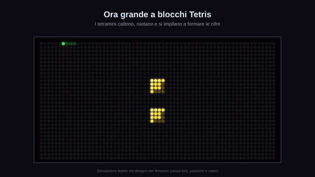
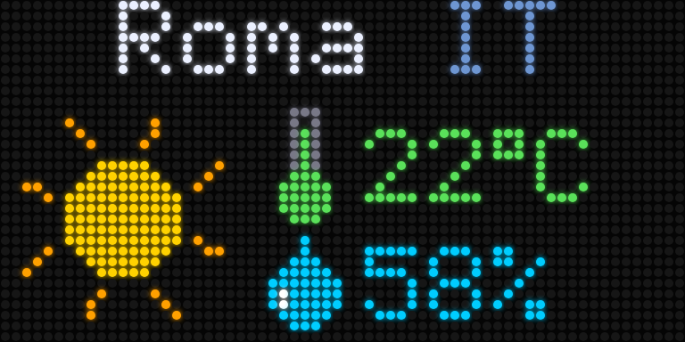
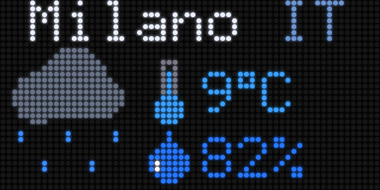
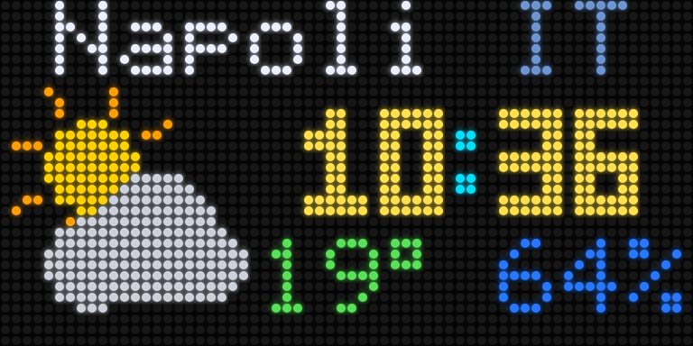
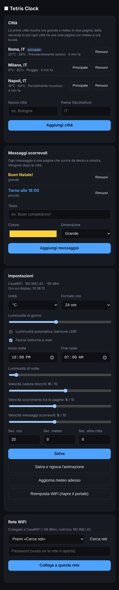
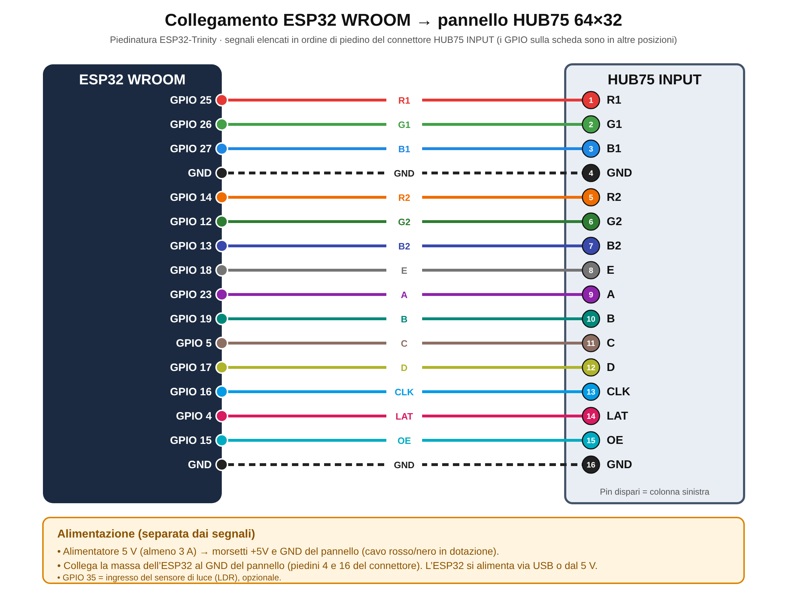

# Tetris Weather Clock

Orologio a blocchi Tetris per **ESP32 WROOM** e pannello **HUB75 64×32**, con meteo animato.

- **Ora grande**: cifre alte 28 pixel e larghe 12, a tratto spesso (griglia 3×7 di blocchi da 4 px), fatte di tetramini veri, ognuno di un colore vivo diverso (rosso, arancio, giallo, verde, ciano, blu, viola) con rilievo marcato. I pezzi cadono uno alla volta, ruotano e si spostano di lato durante la caduta e si impilano a formare la cifra. Quando una cifra cambia, i vecchi pezzi cadono fuori dal pannello.
- **Scorrimento**: il passaggio tra le pagine scorre da destra a sinistra; la velocità si regola dal web (da circa 1,6 s a 0,2 s).
- **Meteo piccolo**: nome della città e del paese in alto (scorre se è lungo), icona animata (sole che ruota, luna e stelle, nuvole, pioggia, neve, temporale, nebbia), termometro e goccia colorati con temperatura e umidità in carattere piccolo.
- **Velocità regolabile** dalla pagina web (1–10), con il pulsante «Salva e rigioca l'animazione» per vedere subito l'effetto.
- **Più città**: la prima mostra ora grande + meteo; dalla seconda in poi ogni città ha una sola schermata con meteo e ora locale (max 6, aggiungi/rimuovi/rendi principale dal web)
- **Messaggi scorrevoli**: pagine di testo (colore, dimensione piccola/grande), max 6, gestite dal web
- Velocità regolabili dal web: caduta blocchi, scorrimento tra le pagine, messaggi
- Pagina web di configurazione: città, messaggi, °C/°F, 12/24 ore, luminosità (anche automatica con l'LDR e con fascia notturna a orari), durata delle schermate
- WiFi configurabile dal telefono (portale captive), senza password nel codice
- **Cambio rete WiFi dalla pagina web**: «Cerca reti», scegli la rete (o inserisci una nascosta), password, «Collega». Se la nuova rete non risponde entro 15 secondi il display rimette quella precedente
- Ora via NTP, fuso e ora legale seguiti dalla città scelta
- **5 lingue** (italiano, English, español, français, Deutsch): si sceglie dal menu nel portale WiFi al primo avvio e si cambia in qualsiasi momento dalla pagina web. Cambiano i testi della pagina web, le condizioni meteo e i nomi delle città (arrivano nella lingua scelta)
- Installazione da browser con un clic (ESP Web Tools)

## Come appare



**[▶ Video dimostrativo completo (pannello + interfaccia web)](docs/demo.mp4)** — simulazione fedele del disegno del firmware, non una ripresa del pannello reale.

Le immagini sono ricostruzioni fedeli del disegno del firmware (stesso font, stesse posizioni e colori); sul pannello reale i colori dipendono dal modello. Nella pagina web i dati sono di esempio.

| Ora | Meteo (città principale) |
|---|---|
|  |  |

| Pioggia | Altre città: meteo e ora insieme |
|---|---|
|  |  |

| Messaggio scorrevole (grande) |
|---|
|  |

### Pagine e ordine di rotazione

1. **Ora** grande (blocchi che cadono)
2. **Meteo** della prima città
3. **Altre città**, una pagina ciascuna con meteo e ora locale
4. **Messaggi** scorrevoli, uno per pagina

### Interfaccia web (`http://tetrisclock.local`)



Dalla pagina si gestiscono: città (aggiungi, rimuovi, rendi principale), messaggi (testo, colore, dimensione), unità e formato ora, luminosità di giorno e di notte a orari, velocità di caduta, di scorrimento tra le pagine e dei messaggi, durata delle pagine e rete WiFi.

## Piedinatura (ESP32-Trinity)



| Segnale | GPIO | Segnale | GPIO |
|---|---|---|---|
| R1 | 25 | A | 23 |
| G1 | 26 | B | 19 |
| B1 | 27 | C | 5 |
| R2 | 14 | D | 17 |
| G2 | 12 | E | 18 |
| B2 | 13 | LAT | 4 |
| CLK | 16 | OE | 15 |

LDR opzionale su GPIO 35. I segnali vanno al connettore **HUB75** (IDC 16 poli) del pannello; il GPIO 35 è solo ingresso e serve il partitore con una resistenza. Il pannello va alimentato a **5 V** separatamente (almeno 2–4 A a luminosità alta) con la massa in comune con l'ESP32. Con la scheda ESP32-Trinity il cablaggio è già fatto.

```
ESP32 GPIO   HUB75        ESP32 GPIO   HUB75
25  -> R1                 23 -> A
26  -> G1                 19 -> B
27  -> B1                  5 -> C
14  -> R2                 17 -> D
12  -> G2                 18 -> E (pannelli 64x32 a 1/16 scan: lasciare E collegato anche se non usato)
13  -> B2                  4 -> LAT
16  -> CLK                15 -> OE
```
 Per cambiare i pin modifica i `#define PIN_*` in cima a `src/main.cpp`.

## Installazione automatica da browser

1. Crea un repository su GitHub e carica il contenuto di questa cartella (ramo `main`).
2. In *Settings → Pages* imposta *Source: GitHub Actions*.
3. Il workflow `.github/workflows/build.yml` compila il firmware e pubblica la pagina di installazione.
4. Apri l'indirizzo della pagina con **Chrome o Edge** da computer, collega l'ESP32 e premi il pulsante.

## Compilazione con Arduino IDE (consigliata)

La cartella `TetrisWeatherClock/` e' lo sketch pronto: aprila con **File > Apri** il file `TetrisWeatherClock.ino` (i due file `.h` devono restare nella stessa cartella).

1. **Core ESP32**: *Strumenti > Scheda > Gestore schede*, installa **esp32 by Espressif Systems** (consigliata la 2.0.17; se usi la 3.x e compare un errore sui pin I2S, passa alla 2.0.17). Se manca l'URL: *File > Impostazioni > URL aggiuntivi* `https://espressif.github.io/arduino-esp32/package_esp32_index.json`
2. **Librerie** (*Strumenti > Gestisci librerie*): `ESP32 HUB75 LED MATRIX PANEL DMA Display` (mrcodetastic, 3.0.x), `Adafruit GFX Library` (accetta le dipendenze, es. BusIO), `WiFiManager` (tzapu, 2.0.17), `ArduinoJson` (7.x).
3. **Scheda**: *ESP32 Dev Module*. **Partition Scheme**: *Default 4MB with spiffs*. **Upload Speed** 115200 (a 921600 puo' dare «Unable to verify flash chip connection»).
4. Premi **Carica**. Se resta su "Connecting...", tieni premuto BOOT sull'ESP32.
5. Per la pagina di installazione da browser: *Sketch > Esporta binario compilato*; la cartella `build` contiene bootloader, partizioni e app separati (con il core 2.0.17 non esiste il file `.merged.bin`): `web/firmware/tetris-clock.bin` e' gia' l'immagine unita (bootloader 0x1000, partizioni 0x8000, app 0x10000) compilata con core esp32 2.0.17 e HUB75 3.0.10.

## Compilazione manuale (PlatformIO, alternativa)

```
pio run -t upload
```

## Primo avvio

1. Collegati alla rete WiFi `TetrisClock` (si apre il portale; altrimenti `192.168.4.1`), scegli la tua rete e la **lingua** dal menu «Lingua / Language».
2. Il display fa scorrere l'indirizzo di configurazione. Apri `http://tetrisclock.local` (o l'IP) e imposta la città.

## Cambiare rete WiFi

Dalla pagina `http://tetrisclock.local`, scheda «Rete WiFi». Se la nuova rete è diversa da quella del telefono, la pagina smette di rispondere: collega il telefono alla nuova rete e riapri `http://tetrisclock.local` (o l'indirizzo che scorre sul display). La password viaggia in chiaro sulla rete locale, come il resto della pagina, che non ha login. «Reimposta WiFi» cancella la rete salvata e riapre il portale `TetrisClock`.

## Struttura del codice

- `src/main.cpp`: display, meteo, WiFi, pagina web
- `src/TetrisEngine.h`: motore dei blocchi (nessuna dipendenza). Divide ogni cifra in pezzi, calcola in anticipo e verifica il percorso di ciascuno (rotazioni, spostamenti, caduta) e lo riproduce a tick
- `src/TextUtil.h`: toglie gli accenti dai nomi di città (il font del pannello è solo ASCII)
- `tools/engine_test.cpp`: test del motore sul computer, senza scheda:
  `g++ -std=c++11 -Isrc tools/engine_test.cpp -o /tmp/engine_test && /tmp/engine_test`

## Regolazioni nel codice

- Velocità: tabella dei millisecondi per tick in `tickMs()` (`main.cpp`)
- Durata dello scorrimento: tabella in `trMs()` in `main.cpp`; colori dei pezzi: `KC` in `main.cpp`
- Posizione delle cifre: `SLOT_X` in `main.cpp`; forma delle cifre: `FONT` in `TetrisEngine.h`
- `DEFAULT_TZ`: fuso usato prima di conoscere la città
- Colori sbagliati o disturbi sul pannello: in `setupDisplay()` prova `mxconfig.clkphase = false;` oppure `mxconfig.driver = HUB75_I2S_CFG::FM6124;`
- Luminosità automatica: l'intervallo di lettura dell'LDR è in `updateBrightness()`

## Note

- In formato 12 ore l'ora resta nelle stesse posizioni (quando l'ora ha una sola cifra, la prima resta vuota) e un piccolo puntino ciano in basso indica il PM.
- Il meteo arriva da [Open-Meteo](https://open-meteo.com/) (nessuna chiave API): sono i dati della città, non di un sensore locale.
- Le richieste HTTPS non verificano il certificato (`setInsecure()`): vanno bene per dati meteo pubblici.
